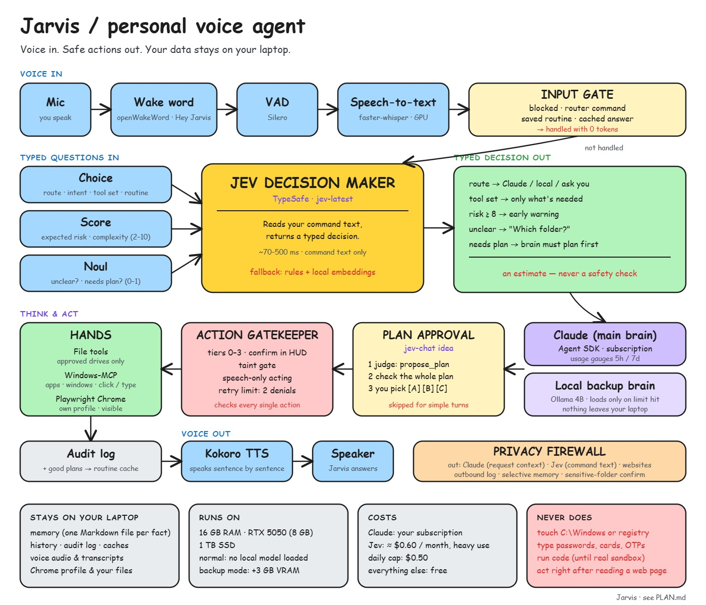

# Jarvis — Personal Voice Agent

A voice-controlled personal agent for my Windows laptop. Say **"Hey Jarvis"**,
ask for something, and it answers out loud or does it — opening apps, typing,
searching the web, working with files.

The goal (see [PLAN.md](PLAN.md)) is an agent that:

- works freely inside approved drives and **asks before going further**,
- puts **every action behind a safety gatekeeper** in code, not in the prompt,
- keeps memory, history and logs **on this laptop**,
- uses Claude (via subscription) as the main brain, with a private local model
  as backup.



---

## Status

| Phase | What | State |
|---|---|---|
| 0 | Setup, voice loop on a local model | ✅ Done |
| 1 | Claude brain + gatekeeper + non-admin account | ✅ Code done — verify on the laptop; set up the account with [docs/NON_ADMIN_ACCOUNT.md](docs/NON_ADMIN_ACCOUNT.md) |
| 2 | Router, answer cache, brain selector + on-demand backup, gauges, notices, decision maker, plan approval | ✅ Code done — run [docs/TEST_RUN.md](docs/TEST_RUN.md) |
| 3 | Desktop control via Windows-MCP, behind the gatekeeper | ✅ Code done — run [docs/TEST_RUN.md](docs/TEST_RUN.md) §14 |
| 4 | Browser: Jarvis's own visible Chrome via Playwright | ✅ Code done — run [docs/TEST_RUN.md](docs/TEST_RUN.md) §15 |
| HUD | Bento tiles + particle swarm; settings drawer with brain and Claude model; voice settings commands | ✅ Code done — run [docs/TEST_RUN.md](docs/TEST_RUN.md) §3.7–3.16, §16 |
| 6 (part) | **Task memory**: one markdown file per task + search ("what did I do last week?"); secrets never saved | ✅ Code done — run [docs/TEST_RUN.md](docs/TEST_RUN.md) §17 |
| 5–7 | Voice quality, rest of memory, extras | Planned |

**Working now:** wake word → speech-to-text on the GPU → **Claude** (via the
Claude Agent SDK on your Claude subscription) with Jarvis's 29 tools → spoken
reply (Kokoro), plus the web HUD. If Claude fails (not logged in, limit hit, no
internet), that request falls back to the local brain (Ollama `qwen3:4b-q4_K_M`).

**Claude brain** (`jarvis/brain/`): one persistent Claude session. Claude gets
only Jarvis's own tools (served in-process as `mcp__jarvis__*`), and each call
goes through the gatekeeper. Claude Code's built-in tools (Bash, Write, Read, …),
your Claude Code settings and other MCP servers are blocked/ignored. Before
starting Claude, Jarvis removes `ANTHROPIC_*` (and backend-switch) variables
from its environment so usage always goes to your subscription, not an API key.
Token use per request is printed and sent to the HUD as a `usage` event.

**Input gate** (`jarvis/input_gate.py`), before any brain runs:
- Obviously forbidden requests (format a drive, delete Windows files, wipe the
  PC, turn off Defender/firewall, show saved passwords, shut down the PC) are
  refused with **0 tokens**. Narrow on purpose — anything it misses still meets
  the gatekeeper.
- **Daily Claude budget** (`brain.daily_claude_budget`, default 100 requests):
  one heads-up at 80 %, and once it's used up the local brain answers for the
  rest of the day. Counts live in `data/usage.db`.

**Phase 2 — fewer tokens, smarter routing:**
- **Instant commands** (`jarvis/router_cmds.py`): time/date, open known apps or
  websites, volume, media, scroll, lock, screenshot, system info, timers — no brain.
  Also Jarvis's own settings: "use the local brain" / "switch to Claude", "use Sonnet /
  Opus / Haiku", "which brain are you using", "mute yourself" / "talk again", "speak
  faster / slower / normally". The HUD settings drawer has the same Claude model picker.
  These are router-only (no brain tool can change them) and work even when Claude's
  daily budget is spent. Adding brains, API keys and speech-to-text settings stay in the HUD.
- **Answer cache** (`jarvis/cache/answers.py`): general questions are answered from
  cache for 7 days (never personal or time-sensitive ones). Say "clear cache".
- **Brain selector** (`jarvis/brain/selector.py`): Claude first; on failure it backs
  off and the local brain answers. The local model loads only when needed (after a
  free-VRAM check) and is unloaded when Claude is back.
- **Gauges**: Claude requests/tokens in the 5-hour and 7-day windows, today's
  budget, GPU VRAM — in the HUD's Claude and GPU tiles (`GET /api/usage`).
- **Notices** (`jarvis/notify.py`): urgent ones spoken now (timers), routine ones
  batched at the next pause.
- **Decision maker** (`jarvis/decision/`): rules decide route, risk, complexity,
  "unclear?" (asks before spending tokens) and "needs a plan?". The TypeSafe Jev
  model plugs in later (`jev_client.py`).
- **Plans** (`jarvis/judge.py`): multi-step or file-changing requests get one plan
  card; every step is checked first, approved steps run without asking again.

**Phase 3 — desktop control** (`jarvis/tools/windows_mcp.py`): at startup Jarvis
runs [Windows-MCP](https://github.com/CursorTouch/Windows-MCP) (`uvx windows-mcp serve`,
needs `uv`; the first start downloads it) as an MCP client and gives both brains
its tools as `win_*`: Snapshot (labelled UI elements), Click, Type, Scroll, Move,
Shortcut, Wait, WaitFor, App, PowerShell. Clicking by element label is far more
reliable than the OCR + coordinates tools, which stay as the fallback if
Windows-MCP can't start. Never loaded: Registry, FileSystem, Process, Clipboard,
Scrape and the rest. Every call goes through the gatekeeper: PowerShell through
the shell checker, `App launch_executable` and risky shortcuts need your OK, and
after Jarvis reads the screen it asks **once per task** to click and type.
Turn it off with `desktop.backend: ocr`.

**Phase 4 — browser** (`jarvis/tools/browser/`): Jarvis opens its **own visible
Chrome window** (Playwright, separate profile in `data/chrome-profile` — none of
your normal logins) on the first web request. Tools: `browser_open`,
`browser_search` (DuckDuckGo by default), `browser_read` (page text + numbered
links/buttons/fields), `browser_click`, `browser_type`, `browser_scroll`,
`browser_back`, `browser_tabs`. "open youtube.com" opens there too. The
gatekeeper looks at what's being clicked or typed into:

| Action | Tier |
|---|---|
| Open pages, search, read, scroll, back, tabs, click ordinary links/buttons, type in search boxes | Free |
| Type into other form fields, click a download link (saved to `Downloads\Jarvis`), anything not from the last read | Ask |
| Buttons that buy, pay, send, post, submit, delete, accept, sign in; typing + submitting a form | Click only |
| Typing into password, card, CVV, OTP / one-time-code fields | Never — you type it |

Page text is untrusted: after reading a page, Jarvis asks once per task to click
and type, and opening another URL asks separately. Read pages are cached for 30
minutes. Setup: `playwright install chromium` is only needed if Google Chrome
isn't installed (`browser.channel: chrome` uses your installed Chrome binary with
the separate profile).

**Task memory** (`jarvis/tasks.py`, early Phase 6): every request you make becomes a
readable file — `data/tasks/2026/10/2026-10-22_153012_email-my-resume-to-priya.md` —
with metadata (date, status, files, sites, apps, tags) and what you asked, what Jarvis
did, the result and its reply. A local index (Chroma, same small local model as the
facts memory) finds tasks by meaning plus time words ("last week", "on Thursday",
"3 days ago"); the brain gets a read-only `search_tasks` tool that returns only the
2–3 matching files. Ask "what did I do with my resume last week?".

- **You're in control:** open, edit or delete the files — the index follows at the next
  start. Say "forget that task" or "forget today". Tasks older than 90 days are removed
  (`tasks.retention_days`, 0 = keep). The security audit log (`data/audit.db`) is
  separate and is not affected by "forget".
- **Safe:** secrets (passwords, PINs, OTPs, card/Aadhaar/PAN numbers, API keys) are
  replaced with `[hidden]`; text read from web pages or the screen is never copied in;
  Jarvis's own folder is always blocked for tools, so nothing can plant fake memories;
  `search_tasks` counts as untrusted, so acting after reading history asks you first.
- **Facts memory fix:** "my password …" is no longer saved as a fact, anything that looks
  like a secret is skipped, and at start-up old secret-looking facts are deleted.
- Optional `config.yaml` keys: `tasks: {enabled: true, dir: data/tasks, index: data/tasks_index, retention_days: 90}`.

**Account check:** at startup Jarvis warns (console + voice) if it runs with
administrator rights. Run it as a standard user —
[docs/NON_ADMIN_ACCOUNT.md](docs/NON_ADMIN_ACCOUNT.md).
Every tool call goes through the gatekeeper (`jarvis/security/`): tiers 0–3,
free folders = `tools.allowed_paths` (Documents, Desktop, Downloads), protected
folders blocked, only turns you start can act, taint gate after reading the web
/ screen / clipboard, and the turn stops after 2 blocks. Decisions are logged to
`data/audit.db`.

**Approvals:** when an action needs your OK, the HUD shows an **Allow / Deny**
dialog and Jarvis asks out loud. Tier 1 — click or say "yes" / "no". Tier 2
(e.g. overwriting a file) — click only. No answer in 30 s, or Esc, = deny.
Say **"full access for 10 minutes"** (click to approve, max 15) to skip Tier 1
asks for a while; the HUD shows a countdown with an END button, or say
**"end full access"**. Tier 2, Tier 3 and the taint gate still apply during
full access. The HUD only accepts requests from its own page (Origin check).

**Known issues**

- Speed (measured, Claude Sonnet): you stop talking → Jarvis starts speaking in
  **~3.7 s** for a Claude answer and **~1.5 s** for an instant command. The biggest
  remaining piece is Kokoro on the CPU (~0.9 s per first sentence); the console
  prints a `[Timing]` line after every spoken reply.
- Local brain: use the **hybrid** `qwen3:4b-q4_K_M`, not plain `qwen3:4b`. The
  plain tag is now Qwen3-4B-*Thinking*-2507, which always reasons: `think: false`
  can't turn it off, and its reasoning ends up in the spoken reply. With the
  hybrid model and `think: false` (in `config.yaml`) answers take ~1–2 s instead
  of 12–35 s; set `think: true` to turn reasoning back on.
- `set_volume` / `get_volume` report success but don't change anything.
- Approvals need the HUD open: Tier 2 (overwrite, full access) is click-only, and
  with no HUD open those time out and are denied. Tier 1 can also be answered
  by saying "yes" / "no".
- After Jarvis reads the screen (screen text counts as untrusted), it asks once
  per task before clicking and typing.

---

## Setup (Windows)

**Needs:** Windows 10/11, an NVIDIA GPU (tested on RTX 5050 8 GB),
[Python 3.12](https://www.python.org/downloads/) (Kokoro doesn't support 3.13+),
[uv](https://docs.astral.sh/uv/), [Ollama](https://ollama.com/download).

```bash
git clone https://github.com/Vinoth-M-08/Jarvis.git
cd Jarvis

uv venv --python 3.12 .venv
uv pip install --python .venv\Scripts\python.exe -r requirements.txt pip
.venv\Scripts\python.exe -m spacy download en_core_web_sm

ollama pull qwen3:4b-q4_K_M
```

**Claude brain:** Jarvis runs the copy of Claude Code that comes with
`claude-agent-sdk`. Log it in once with your **Claude subscription** account (not
an API key): run
`.venv\Lib\site-packages\claude_agent_sdk\_bundled\claude.exe` in a normal
terminal, type `/login`, then `/exit`. (Logging in to the Claude desktop app does
*not* do this; if the console shows `Failed to authenticate: OAuth session
expired`, run `/login` there again.) The provider is `claude` in `config.yaml`
(`model: claude-sonnet-5-5` — quickest to start talking; say **"use Opus"** for big
jobs). Change the model in the HUD (**Settings → Claude model**: Opus / Sonnet /
Haiku 5.5) or by voice — it applies from the next request, no restart. To run fully local, say **"use the
local brain"** or pick it in the header dropdown. Other Claude settings
(`max_turns`) are only in `config.yaml`; the HUD's "add a brain" form is for
OpenAI-compatible / Ollama brains.

Speech models (Whisper `small`, Kokoro, the wake word) download on first run.
CUDA libraries for Whisper come from the `nvidia-cublas-cu12` /
`nvidia-cudnn-cu12` packages — no CUDA toolkit install needed. The very first
GPU transcription takes about 90 s while the GPU compiles; after that it's cached.

## Run

```bash
start.bat
```

Wait for **"Jarvis online"** (≈30 s on first start). The HUD opens at
http://localhost:7860 (localhost only).

| Input | Action |
|---|---|
| **"Hey Jarvis"** → chime → speak | Give a command |
| Keep talking after the reply (soft cue, ~8 s) | Follow-up — no wake word needed |
| **"thanks"** / **"that's all"** (or just stay quiet) | End the conversation |
| **"Hey Jarvis"** while busy, or **"stop"** | Interrupt |
| **Esc** | Stop everything |
| **F2** | Type a command in the console |
| **Insert** | Mute / unmute Jarvis's voice |
| HUD chat box | Type a command |
| HUD **Settings** (gear) | Brains, Claude model, voice, speech-to-text, wake word |

**HUD** (`jarvis/static/index.html`, one page, no build step) — bento tiles:

| Tile | Shows |
|---|---|
| Header | Connection, ask box, **brain dropdown**, mute, **Settings**, Stop |
| Jarvis (big) | A 130-dot **particle swarm** that changes shape and colour with what Jarvis is doing, plus a caption |
| Approvals | "Nothing needs you", or the amber **Can I go ahead?** card: steps, safer option, countdown, Deny / Allow |
| Full access | Countdown and **End** while full access is on |
| Current task (cream) | This request's steps — spinner while running, ✓ done, ! blocked |
| Claude (blue) | Requests today / budget, 5-hour and 7-day counts |
| GPU (mint) | VRAM used, temperature, whether the backup brain is loaded |
| Conversation · Today · Systems | Chat log · last actions (done / blocked / waiting) · Claude, Backup, Desktop, Browser dots |

| State | Swarm | Colour |
|---|---|---|
| Idle | Loose drifting cloud | Grey |
| Listening | Pulsing ring | Blue |
| Thinking | Three spinning clusters | Purple |
| Speaking | Travelling wave, reply as caption | Green |
| Needs your OK | A hopping **?** | Amber |

When Jarvis isn't reachable the HUD says so instead of showing zeros: the brain
dropdown reads **"Brain: offline"** and the tiles **"Not connected"**; they fill in
by themselves once Jarvis is up. Tiles stack on narrow windows.

**Troubleshooting**

| Problem | Check |
|---|---|
| Doesn't react to "Hey Jarvis" | Windows mic not muted: *Settings → System → Sound → Input*. Then lower `wake_word.threshold` in `config.yaml` (e.g. 0.3). |
| No voice | Insert / HUD mute toggled, or say "talk again". Windows output device and volume. |
| HUD shows "Brain: offline" / "Not connected" | Jarvis isn't running, or the page was opened as a file. Run `start.bat`, open http://localhost:7860, Ctrl+F5. |
| Old-looking HUD after `git pull` | Ctrl+F5 to reload the page. |
| Brain errors | Ollama running? `ollama list` should show `qwen3:4b-q4_K_M`. |

---

## Layout

```
config.yaml          settings (models, voice, paths)
start.bat            launcher
jarvis/
  main.py            pipeline: wake → listen → think → speak
  wake.py stt.py tts.py
  web.py static/     HUD (FastAPI + WebSocket, 127.0.0.1; static/index.html = bento + swarm)
  memory.py context.py llm.py
  tasks.py           task memory: a markdown file per task + search_tasks
  router_cmds.py     0-token instant commands (incl. brain / model / mute / speed / forget)
  decision/ judge.py decision maker + plan approval
  tools/router.py    tool list + dispatch (risky tools disabled)
  tools/windows_mcp.py tools/browser/   desktop control, Jarvis's own Chrome
  security/          gatekeeper, policy, path checks, shell parser, audit log, secret redaction
  brain/             Claude Agent SDK brain + subscription env guard, selector, usage
tests/               pytest
data/                audit.db, usage.db, tasks/ (your task files) and other runtime data (git-ignored)
PLAN.md              full build plan
NVIDIA_UPGRADES.md   GPU extras (Broadcast mic, CUDA checks, VRAM gauge)
```

```bash
.venv\Scripts\python.exe -m pytest -q
```

---

## Credits

Started from [PanPenek/JarvisAi](https://github.com/PanPenek/JarvisAi)
(MIT, commit `9dcf62b`) — the Windows voice pipeline, tools and HUD. The first
commit in this repo is that code unchanged. Other projects that shaped the plan
are listed in [PLAN.md §9a](PLAN.md#9a-inspirations--credits).

Built on [openWakeWord](https://github.com/dscripka/openWakeWord),
[faster-whisper](https://github.com/SYSTRAN/faster-whisper),
[Kokoro-82M](https://huggingface.co/hexgrad/Kokoro-82M),
[Ollama](https://ollama.com/), [ChromaDB](https://www.trychroma.com/) and
[FastAPI](https://fastapi.tiangolo.com/).

## License

Private project. The upstream code it builds on is MIT-licensed
(© PanPenek; stated in the upstream README, which ships no LICENSE file).
